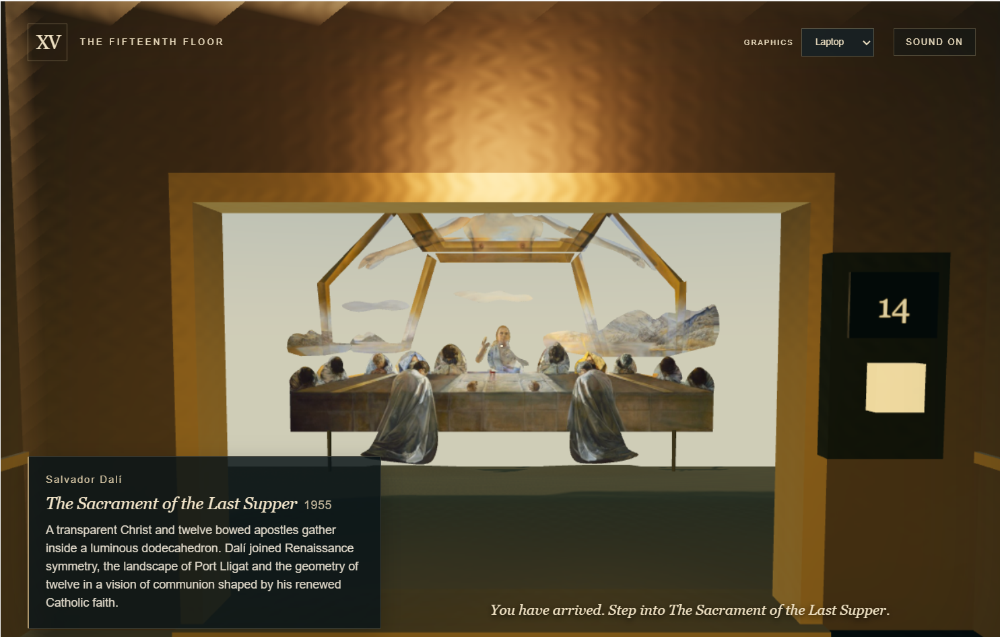
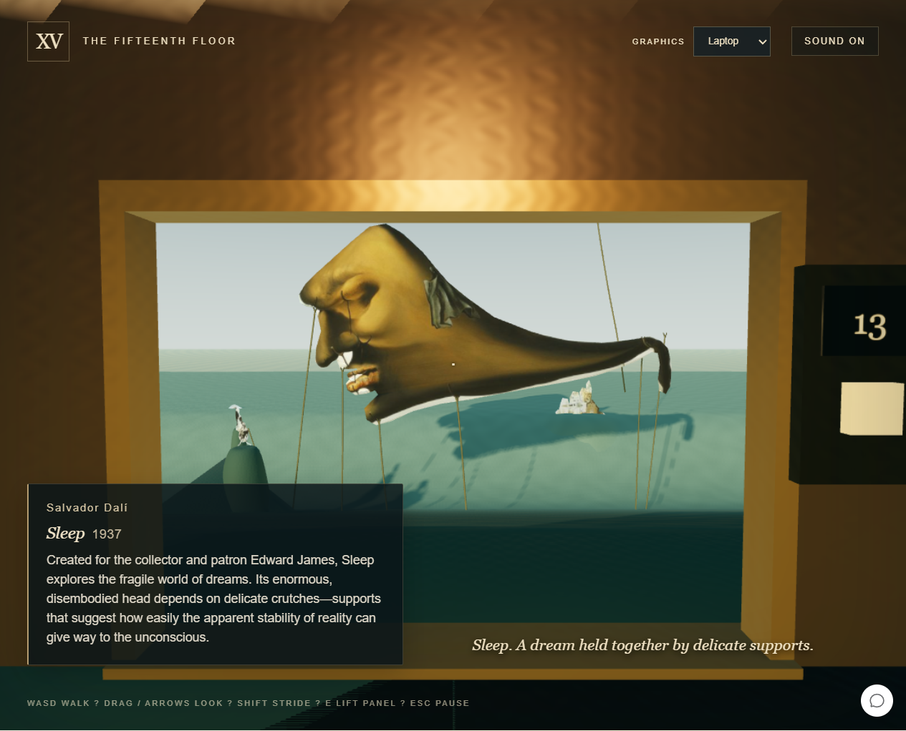
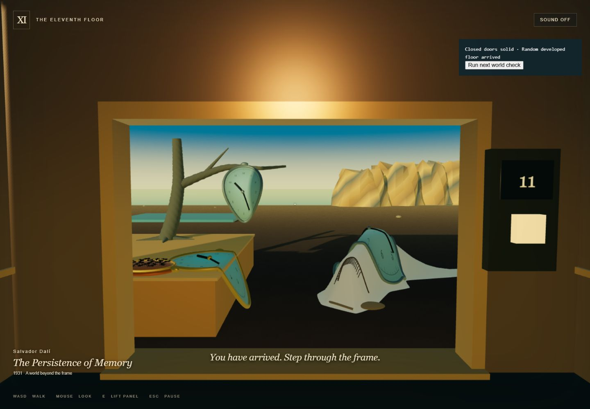

# The Fifteenth Floor

A playable first-person experiment exploring fifteen Salvador Dalí paintings through an elevator. Built with Three.js, TypeScript and Vite. The name reflects the fifteen painting worlds in the collection.

Play here: https://the-fifteenth-floor.vercel.app/

## The experiment

This project explores how **GPT-6.1 Sol** could interpret Surrealist paintings and develop them into spaces you can step into. Salvador Dalí’s paintings served as visual references, while the model helped turn their unusual forms, perspectives and atmosphere into an interactive 3D experience through code.

The process combined prompting, generated code, reference-image study, human playtesting and repeated revisions. Early versions used simplified geometry; later passes focused on composition, shaped volumes, painted surfaces, lighting and depth. The result is an experiment in AI-assisted interpretation and game development, rather than an attempt to replace the original artworks or claim that the model created them.

Each painting occupies a separate floor. The elevator links the worlds into one explorable collection, with artwork titles, dates and short background notes. These are artistic interpretations, and some illusions are strongest from the initial reveal viewpoint.

## Screenshots

Three different painting worlds, captured in-game. The Last Supper and Sleep screenshots show the current reconstructions; The Persistence of Memory image documents the earlier playable prototype.

### The Sacrament of the Last Supper — 1955



### Sleep — 1937



### The Persistence of Memory — 1931

Earlier prototype, before the painted-surface rebuild and rename from **The Eleventh Floor**.



## Download and run

You need **Node.js 22.12 or newer**, including npm, and a desktop browser with WebGL support. A keyboard and mouse are recommended.

1. On this repository’s GitHub page, select **Code**, then **Download ZIP**.
2. Extract the ZIP. Keep the entire folder, including `src/`, `public/`, `package.json` and `package-lock.json`.
3. Open a terminal in the extracted folder containing `package.json`.
4. Install the locked dependencies and start the game:

```sh
npm ci
npm run dev
```

Open **http://127.0.0.1:5173/**, or the local address printed by Vite if that port is occupied. Keep the terminal running while you play. Press **Ctrl+C** in the terminal to stop the server.

Use the local server; opening `index.html` directly will not launch the game correctly. On Windows, `npm.cmd` can be used instead of `npm`.

To download with Git instead, copy the repository’s HTTPS URL from the **Code** menu and clone it. Open the cloned folder and run the same commands above.

### Production build

```sh
npm run build
npm run preview
```

Open **http://127.0.0.1:4173/**. The build output is in `dist/`; it can be served by a static web host. No API key or backend service is required to play locally.

## Play

Click **Step inside**, face the illuminated cabin panel, and press **E**. The elevator visits every painting in a shuffled circuit before reshuffling, without consecutive repeats. Walk out, explore, and return to the cabin to travel again.

- **WASD**: walk.
- **Mouse**: look; **Shift**: longer stride.
- **E**: use the elevator panel while inside.
- **Esc**: pause and release the cursor; click **Step inside** to resume.
- **Sound** and **Graphics**: change settings while the cursor is released.

If pointer lock is blocked, drag or use arrow keys to look. Audio starts after a user gesture and is optional.

For a direct first ride, append `?floor=<id>` to the URL. Click **Step inside** and that first ride starts automatically. Later rides resume the shuffled circuit. Every floor retains its bottom-left artist, title, date and background card.

## Collection

| Floor | Painting | Direct-link id |
| --- | --- | --- |
| 11 | The Persistence of Memory, 1931 | `persistence-of-memory` |
| 12 | The Elephants, 1948 | `the-elephants` |
| 13 | Sleep, 1937 | `sleep` |
| 14 | The Sacrament of the Last Supper, 1955 | `last-supper` |
| 15 | Christ of Saint John of the Cross, 1951 | `christ-of-saint-john` |
| 16 | Galatea of the Spheres, 1952 | `galatea-spheres` |
| 17 | Swans Reflecting Elephants, 1937 | `swans-reflecting-elephants` |
| 18 | Metamorphosis of Narcissus, 1937 | `metamorphosis-narcissus` |
| 19 | The Madonna of Port Lligat, 1949 | `madonna-port-lligat` |
| 20 | The Swallow’s Tail, 1983 | `swallows-tail` |
| 21 | Dream Caused by the Flight of a Bee Around a Pomegranate a Second Before Awakening, 1944 | `dream-bee` |
| 22 | The Great Masturbator, 1929 | `great-masturbator` |
| 23 | The Burning Giraffe, 1937 | `burning-giraffe` |
| 24 | Galacidalacidesoxiribunucleicacid (Homage to Crick and Watson), 1963 | `galacidalacidesoxyribonucleicacid` |
| 25 | The Discovery of America by Christopher Columbus, 1958–1959 | `discovery-of-america` |

## Reconstruction and graphics

Foreground figures, watches, animals, architectural fragments and rocks are separate curved or closed volumes. Their painted pigment comes from local reference textures, anchored in world coordinates to the authored reveal viewpoint. Physical lighting defines the sides and backs. Moving changes perspective and reveals the separated depth; there is no full-painting scenery plane.

The final pass adds shaped anatomy and robes, original painted detail, traced silhouettes, thicker sculptural curves, independent architectural pieces, and corrected ground contact. Sleep retains a closed head and grounded crutches. Swans uses modeled elephant reflections below transparent water, without another reflection render. The Burning Giraffe retains animated fire. The clock shore has a solid receding platform, sagging watches, a sleeping form, modeled ants and substantial distant cliffs. The Swallow’s Tail remains a sculptural interpretation of the original line drawing.

The default **Laptop** preset targets the detected Snapdragon X X126100 / Adreno X1-45 integrated GPU and approximately 16 GB shared RAM. These are resource limits, not measured frame-rate guarantees.

| Preset | Maximum rendered pixels | Shadow map | Sand motes |
| --- | ---: | ---: | ---: |
| Battery | 650,000 | 512² | 60 |
| Laptop | 1,000,000 | 1024² | 120 |
| Detailed | 2,000,000 | 2048² | 180 |

Every floor stays below 90,000 triangles. Current totals range from about 22,840 to 86,042 triangles and 3–11 meshes per floor, excluding the elevator and dust points. Only the selected world renders. Geometry is batched, and small ant details use instancing. Laptop can reduce internal resolution after sustained frame rates below 28 FPS. Static shadows are reused while walking; pausing stops continuous rendering.

Water uses environment lighting. There is no SSAO, bloom, ray tracing, screen-space reflection or per-frame full-scene mirror. Pigment textures are local; visiting floors does not require third-party image requests.

## Sound

Web Audio synthesizes the elevator hum and bell, footsteps, filtered wind and quiet spatial tones. Sacred scenes, mathematical scenes and the Burning Giraffe use different restrained sound beds. The same loop and two voices are retuned on arrival, so repeated travel does not accumulate audio nodes. Audio fades when paused; mute is remembered. No downloaded audio is required.

## Verification

```sh
npm run check:level
npm run build
```

The checks instantiate the actual production floors and verify finite geometry, budgets, all fifteen artwork cards, No. 8’s exclusion, material shader connections, and four complete shuffled circuits. Grid traversal proves a clear entrance and reachable routes around the scenes. Dedicated checks exercise eight elephant-foot collisions, the solid miniature pavilion, return routes, and Sleep’s closed head manifold.

Grounded figures and structures were checked against terrain; local shore shelves and denser support patches correct floating or buried forms. Sacred-scene principal feet and bases were also checked against rendered terrain with raycasts. Existing pixel and shadow budgets remain unchanged.

CPU composition studies were inspected for all thirteen new rebuilds. They check reference framing and modeled silhouettes, not final WebGL rendering. To reproduce them on Windows:

```powershell
.openai/qa/prepare-pigment-studies.ps1
node .openai/qa/render-painted-collection.mjs sleep
```

Generated pixel buffers and studies are ignored by Git. The optional `?verify&floor=<id>` panel uses normal movement and the elevator interaction; calibrated worlds have routes around their right, back and left sides.

Browser automation still fails to start in this Windows environment. Final browser shader compilation, appearance, audio mix, resizing, native pointer capture and actual GPU FPS remain unverified. CPU studies are not browser screenshots.

## Code and references

- `src/exhibits/PaintedWorld.ts`: reference calibration, closed painted volumes, capped curves, pigment sampling and batching.
- `src/exhibits/MemoryReconstruction.ts`: current clock shore; `PersistenceOfMemory.ts` retains the sky helper and original construction reference.
- `src/exhibits/Galatea.ts`, `TheElephants.ts`, `ElephantSculptures.ts`: accepted dedicated reconstructions.
- `src/exhibits/Sleep.ts`, `src/exhibits/collection/`: the remaining modeled floors.
- `src/Artwork.ts`: shared artwork cards and source metadata.
- `src/Floors.ts`, `src/Graphics.ts`, `src/Sound.ts`: travel, hardware budgets and audio.
- `src/Controls.ts`, `src/Elevator.ts`, `src/main.ts`: first-person play, elevator and scene integration.

Modeling references live under `references/`; runtime pigment assets live under `public/textures/`. Artwork context and primary museum/catalogue links are stored with each card. These are local three-dimensional interpretations of the paintings.
